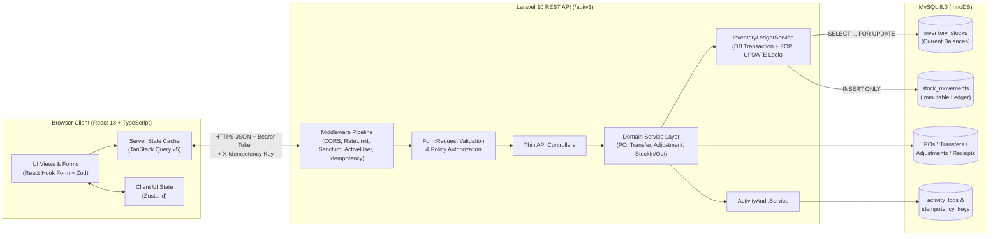

# System Architecture Specification
## Strata WMS — Enterprise Inventory & Warehouse Management System

---

## 1. Architectural Overview

Strata WMS is architected as a decoupled **Client-Server Monorepo** consisting of a stateless/token-authenticated **Laravel 10 REST API** backend and a **React 18 + TypeScript** single-page application (SPA) frontend, backed by **MySQL 8.0 (InnoDB)**.

### 1.1 Monorepo Directory Topology

```text
strata-wms/
├── backend/                     # Laravel 10.x REST API (PHP 8.1+ / MySQL 8.0)
│   ├── app/
│   │   ├── Console/Commands/    # Maintenance & bootstrap CLI commands
│   │   ├── Enums/               # Strongly-typed domain states (MovementType, TransferStatus, etc.)
│   │   ├── Exceptions/          # Domain exceptions (InsufficientStockException, InvalidStateTransitionException)
│   │   ├── Http/
│   │   │   ├── Controllers/Api/V1/  # Thin HTTP controllers grouped by bounded domain
│   │   │   ├── Middleware/      # EnsureActiveUser, CheckPermission, IdempotencyMiddleware
│   │   │   ├── Requests/        # FormRequest validation + input normalization
│   │   │   └── Resources/       # Standardized JSON serialization
│   │   ├── Models/              # Eloquent models, relationships, query scopes
│   │   ├── Policies/            # RBAC + Warehouse-assignment authorization policies
│   │   └── Services/            # Transactional business logic & row-locking ledger engine
│   ├── config/                  # CORS, Sanctum, Auth, Rate Limiting, WMS settings
│   ├── database/
│   │   ├── factories/           # Deterministic model factories for feature tests
│   │   ├── migrations/          # Normalized InnoDB schema with FK constraints & composite indexes
│   │   └── seeders/             # Separated ProductionBootstrapSeeder vs DemoDatasetSeeder
│   ├── routes/api.php           # Versioned /api/v1 REST endpoints
│   └── tests/Feature/           # Real MySQL transactional feature & concurrency tests
├── frontend/                    # React 18 + TypeScript + Vite + Tailwind CSS
│   ├── public/
│   └── src/
│       ├── api/                 # Axios client, auth interceptors, typed endpoint modules
│       ├── app/                 # Router configuration, protected route guards, providers
│       ├── components/
│       │   ├── layout/          # AppShell, Sidebar, Topbar, Breadcrumbs, WarehouseSwitcher
│       │   └── ui/              # Design-system primitives (Button, DataTable, Badge, Modal, Drawer, KpiCard)
│       ├── features/            # Domain modules (dashboard, inventory, products, warehouses, etc.)
│       ├── hooks/               # Debounced search, permissions hook, URL query state sync
│       ├── lib/                 # Formatters (currency, dates, quantities), constants, utils
│       ├── stores/              # Zustand client-only stores (auth session cache, UI layout, active warehouse filter)
│       └── types/               # Shared TypeScript interfaces & API response contracts
├── docker/                      # Dockerfiles & Nginx config for containerized deployment
├── docs/                        # Engineering & Product Documentation
│   ├── 01-PRD.md
│   ├── 02-SYSTEM-ARCHITECTURE.md
│   ├── 03-DATABASE-ERD.md       # Phase 2 deliverable
│   ├── 04-API-DOCUMENTATION.md  # OpenAPI / Swagger + endpoint reference
│   ├── 05-TESTING-GUIDE.md      # Test coverage & execution guide
│   ├── 06-INSTALLATION.md       # Local setup guide
│   └── 07-DEPLOYMENT.md         # Production hardening & backup guide
├── docker-compose.yml           # Full-stack containerized orchestration (App, Nginx, MySQL 8.0)
└── README.md                    # Portfolio-grade project overview
```

---

## 2. High-Level System Context & Request Flow



---

## 3. Technology Stack & Runtime Decisions

### 3.1 Backend Stack & Local Compatibility
- **Runtime**: PHP `8.1+` (verified locally on PHP `8.1.10` CLI/ZTS with `pdo_mysql`, `bcmath`, `mbstring`, `intl`, `gd`, `openssl`; containerizable on PHP `8.2-fpm` in Docker).
- **Framework**: **Laravel 10.x** — chosen deliberately because Laravel 10 provides full first-party support for PHP `8.1+` through `8.3`, ensuring native execution on the local machine without environment hacks while offering full parity in Sanctum, Eloquent, Policies, FormRequests, API Resources, and Pint/PHPUnit.
- **Authentication**: **Laravel Sanctum** using revocable personal access tokens (`Bearer` token authentication with configurable expiration and role/ability metadata), cleanly decoupling SPA/API clients and simplifying Postman/Swagger testing alongside browser sessions.
- **Database**: **MySQL 8.0 (InnoDB)** (`utf8mb4_unicode_ci`) — strictly required for foreign key enforcement, ACID transactions, row-level pessimistic locking (`SELECT ... FOR UPDATE`), and composite B-Tree indexing.

### 3.2 Frontend Stack
- **Build & Core**: Vite + React 18 + TypeScript (strict mode enabled).
- **Styling**: Tailwind CSS configured with custom semantic design tokens matching the Anti-AI-Slop palette (`#F7F8FA`, `#FFFFFF`, `#171A21`, `#667085`, `#E6E8EC`, `#334E85`, `#16845B`, `#B7791F`, `#C2413B`).
- **Routing**: React Router v6 with route-level authentication and permission guards.
- **Server State**: TanStack Query v5 with structured query key factories (`queryKeys.inventory.list(filters)`, `queryKeys.dashboard.summary(warehouseId)`) and targeted cache invalidation after mutations.
- **Client State**: Zustand for lightweight UI state (sidebar collapsed toggle, selected global warehouse filter, active user session snapshot).
- **Forms & Validation**: React Hook Form + `@hookform/resolvers/zod` + Zod schemas, paired with a unified helper that maps Laravel `422` field errors directly onto form inputs.
- **Analytics & Icons**: Recharts (clean, grid-aligned business charts with custom formatted tooltips) and `lucide-react` icons.

---

## 4. Backend Layered Architecture & Core Domain Services

Controllers are kept strictly thin (under ~40 lines per action): they accept a validated `FormRequest`, authorize via `$this->authorize(...)`, delegate business execution to a dedicated **Domain Service**, and return an `ApiResource` or standardized JSON response.

### 4.1 Core Domain Services

1. **`InventoryLedgerService` (The Transactional Kernel)**
   - **Responsibility**: Sole service authorized to modify `inventory_stocks` and insert into `stock_movements`.
   - **Concurrency Control Algorithm**:
     1. Accepts a structured batch of stock mutations inside an active `DB::transaction()` (or opens one).
     2. Sorts all affected `(warehouse_id, product_id, warehouse_location_id)` keys in ascending deterministic order so two concurrent requests touching overlapping SKUs/warehouses can **never** deadlock.
     3. Acquires `SELECT * FROM inventory_stocks WHERE ... FOR UPDATE` on existing rows (or safely initializes missing zero-balance stock rows under unique index protection and locks them).
     4. Validates business invariants (`quantity_on_hand + delta >= 0` and `quantity_on_hand + delta - reserved_quantity >= 0`). Throws `InsufficientStockException` (mapped to HTTP `422`) on violation.
     5. Updates `inventory_stocks` (`quantity_on_hand`, `reserved_quantity`, `last_movement_at`) using `bcmath` / exact integer/decimal arithmetic.
     6. Appends an immutable row to `stock_movements` recording `balance_before`, `quantity_change`, `balance_after`, `unit_cost`, `reference_type`, `reference_id`, `reference_number`, `performed_by`, and `notes`.

2. **`StockInService` & `GoodsReceiptService`**
   - Handles both standalone Stock In transactions and PO-linked Goods Receipts (`GRN-YYYYMMDD-XXXX`).
   - Locks parent `purchase_orders` and `purchase_order_items` (`FOR UPDATE`) when receiving against a PO to prevent two warehouse clerks from simultaneously receiving the same open PO line and exceeding ordered quantities.
   - Recomputes PO status (`approved` -> `partially_received` -> `completed`) automatically.

3. **`StockOutService`**
   - Validates warehouse access for the acting user, verifies product active status, delegates atomic deduction to `InventoryLedgerService`, and records outbound reference/destination metadata.

4. **`StockTransferService`**
   - Manages the state machine: `pending` -> `completed` | `cancelled`.
   - **On Creation (`pending`)**: Locks source stock rows, verifies `available_quantity >= transfer_quantity`, and increments `reserved_quantity` so earmarked stock cannot be accidentally shipped out before the transfer completes.
   - **On Completion (`completed`)**: Locks both source and destination stock rows in deterministic `(warehouse_id, product_id)` order, releases `reserved_quantity` and deducts `quantity_on_hand` at source (`transfer_out`), and increments `quantity_on_hand` at destination (`transfer_in`).
   - **On Cancellation (`cancelled`)**: Locks source stock rows and decrements `reserved_quantity` cleanly.

5. **`StockAdjustmentService`**
   - **Creation**: Warehouse Staff, Managers, or Admins record physical count quantities or shrinkage requests (`status = pending`).
   - **Approval (`approved`)**: Restricted to `Admin` and `Warehouse Manager` (for assigned warehouses). Locks `inventory_stocks`, snapshots actual `previous_quantity` at execution time (or validates against expected count), computes `difference_quantity = adjusted_quantity - previous_quantity`, rejects any negative resulting stock, and writes `adjustment_in` or `adjustment_out` via `InventoryLedgerService`.

6. **`PurchaseOrderService`**
   - Generates sequential document numbers (`PO-YYYYMMDD-XXXX`), calculates exact line totals and order totals (`bcmath` decimal precision), enforces draft editability vs. post-approval immutability, and blocks cancellation if any Goods Receipt has already been posted against the PO.

7. **`DashboardAnalyticsService` & `ReportService`**
   - Executes indexed SQL aggregations (`SUM`, `COUNT`, `GROUP BY` date/warehouse/category) directly in MySQL rather than hydrating thousands of Eloquent models in PHP memory.
   - Enforces warehouse visibility scoping (`WHERE warehouse_id IN (...)`) automatically for non-Admin users.

8. **`ActivityAuditService`**
   - Records structured audit events (`action`, `module`, `subject_type`, `subject_id`, `description`, `properties` JSON with before/after values, `ip_address`, `user_agent`, `user_id`) into `activity_logs`.

---

## 5. Authorization & Multi-Warehouse Access Control Architecture

Authorization combines **Role-Based Access Control (RBAC)** with **Attribute/Scope-Based Warehouse Access**:

1. **Roles & Permissions**:
   - `roles` (`admin`, `warehouse_manager`, `warehouse_staff` + custom admin-defined roles) map many-to-many with `permissions` via `role_permissions`.
   - Fine-grained permission slugs follow `<resource>.<action>` naming:
     - `dashboard.view`
     - `products.view`, `products.create`, `products.update`, `products.archive`
     - `categories.view`, `categories.manage`
     - `warehouses.view`, `warehouses.create`, `warehouses.update`, `warehouses.manage_locations`
     - `inventory.view`, `inventory.stock_in`, `inventory.stock_out`
     - `transfers.view`, `transfers.create`, `transfers.approve`, `transfers.complete`, `transfers.cancel`
     - `adjustments.view`, `adjustments.create`, `adjustments.approve`
     - `purchase_orders.view`, `purchase_orders.create`, `purchase_orders.approve`, `purchase_orders.receive`, `purchase_orders.cancel`
     - `suppliers.view`, `suppliers.create`, `suppliers.update`
     - `reports.inventory`, `reports.transactions`, `reports.export`
     - `users.manage`, `roles.manage`, `settings.manage`
2. **Warehouse Assignment Scope (`user_warehouses`)**:
   - `Admin` users bypass warehouse restriction (`hasGlobalWarehouseAccess() === true`).
   - `Warehouse Manager` and `Warehouse Staff` users are linked to one or more assigned warehouses via `user_warehouses` (plus `warehouses.manager_id`).
   - Backend Policies (`WarehousePolicy`, `InventoryPolicy`, `StockTransferPolicy`, `StockAdjustmentPolicy`, `PurchaseOrderPolicy`) verify **both** the permission slug **and** `$user->canAccessWarehouse($warehouseId)`.
   - For inter-warehouse transfers: creating or dispatching checks access to `source_warehouse_id`; completing/receiving checks access to `destination_warehouse_id` (or manager access).

---

## 6. REST API Design Contract

### 6.1 Base Path & Headers
- **Base URL**: `/api/v1`
- **Headers**:
  - `Accept: application/json`
  - `Content-Type: application/json`
  - `Authorization: Bearer <sanctum_token>`
  - `X-Idempotency-Key: <uuid>` (supported on all mutating stock/order POST actions to prevent duplicate execution on network retries)

### 6.2 Standardized JSON Envelope

**Success (Single Resource / Action):**
```json
{
  "success": true,
  "message": "Stock transfer completed successfully.",
  "data": {
    "id": 42,
    "transfer_number": "TRF-20261124-0008",
    "status": "completed"
  }
}
```

**Success (Paginated Collection):**
```json
{
  "success": true,
  "message": "Inventory stocks retrieved.",
  "data": [ ... ],
  "meta": {
    "current_page": 1,
    "per_page": 20,
    "total": 248,
    "last_page": 13
  }
}
```

**Error (`401`, `403`, `404`, `409`, `422`, `429`, `500`):**
```json
{
  "success": false,
  "message": "Insufficient available stock in WH-JKT-01 for SKU-MON-27.",
  "errors": {
    "items.0.quantity": [
      "Requested 25 units, but only 14 units are currently available (18 on hand, 4 reserved)."
    ]
  }
}
```

---

## 7. Security, Reliability & Operational Architecture

| Concern | Implementation Strategy |
| :--- | :--- |
| **Authentication & Passwords** | Bcrypt/Argon2 password hashing (`Hash::make`), Sanctum token auth, inactive-user immediate token revocation check in middleware, rate-limited `/auth/login` (`5` attempts/minute per IP+email). |
| **SQL Injection Prevention** | Parameterized PDO prepared statements via Eloquent/Query Builder; strict column whitelisting on dynamic `sort_by` and `sort_dir` query parameters. |
| **Concurrency & Idempotency** | InnoDB `SELECT ... FOR UPDATE` with deterministic lock ordering + `idempotency_keys` table storing request hash and cached response for 24h. |
| **CORS & Environment Security** | Explicit allowed origins in `config/cors.php` driven by `FRONTEND_URL` in `.env`; sensitive credentials excluded via `.gitignore`. |
| **Audit & Error Logging** | Structured domain audit log (`activity_logs`) + Laravel daily rotating file/stderr logs with request correlation IDs. |
| **Database Backup Strategy** | Automated `mysqldump --single-transaction --routines --triggers` script & scheduled artisan command documented for daily encrypted snapshots. |
| **Containerization** | Multi-container `docker-compose.yml` (`php-fpm`, `nginx`, `mysql:8.0`, `frontend`) provided alongside native Laragon/Windows execution support. |
