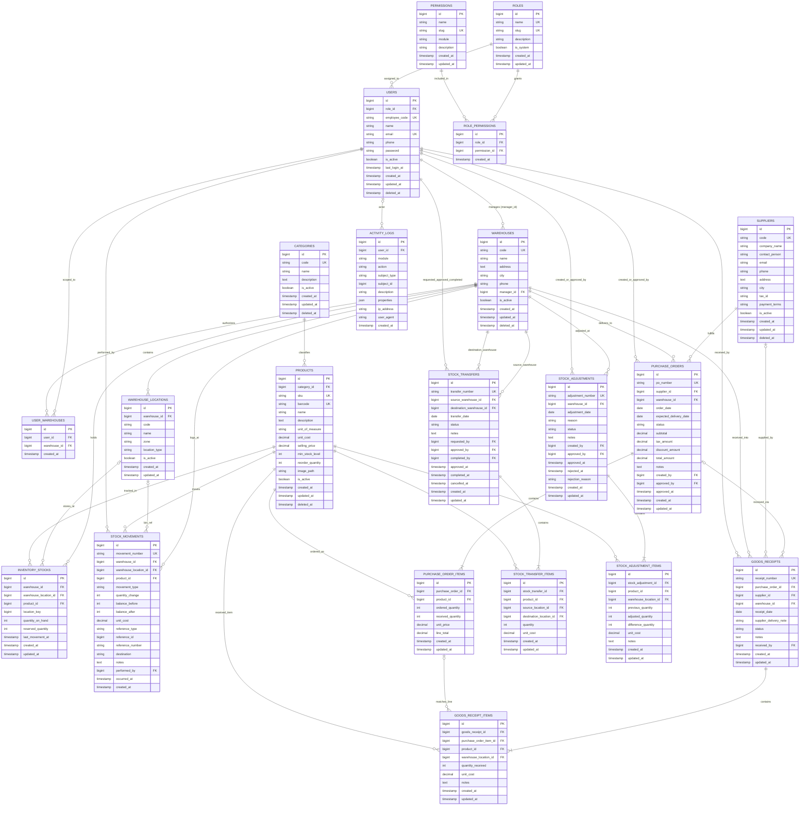

# Complete Database Design & Entity-Relationship Diagram (ERD)
## Strata WMS — MySQL 8.0 Relational Schema Specification

---

## 1. Database Design Principles

1. **Third Normal Form (3NF) with Controlled Ledger Snapshots**:
   - Master reference entities (`products`, `categories`, `warehouses`, `warehouse_locations`, `suppliers`, `users`, `roles`, `permissions`) are strictly normalized.
   - Transactional ledger tables (`stock_movements`, `purchase_order_items`, `goods_receipt_items`, `stock_adjustment_items`) intentionally snapshot point-in-time values (`unit_cost`, `unit_price`, `balance_before`, `balance_after`, `previous_quantity`) so historical financial and audit records never mutate when a product's catalog cost changes later.
2. **Engine & Collation**:
   - All tables use **InnoDB** (`utf8mb4` / `utf8mb4_unicode_ci`) for ACID transactions, foreign key referential integrity, and row-level pessimistic locking (`SELECT ... FOR UPDATE`).
3. **Exact Numeric Types**:
   - Monetary values (`unit_cost`, `unit_price`, `subtotal`, `total_amount`) use `DECIMAL(15, 2)`—never floating-point (`FLOAT`/`DOUBLE`).
   - Quantities (`quantity_on_hand`, `reserved_quantity`, `quantity_change`) use `BIGINT` / `INTEGER` (whole base units, with `DECIMAL(15, 3)` support if fractional units are needed; we standardize on `DECIMAL(15, 2)` or `INTEGER`—specifically `INTEGER` for discrete SKU inventory counts with strict non-negative invariants, or `DECIMAL(14, 2)`? Let's standardize on `INTEGER` (`BIGINT`) for exact discrete unit counts across all inventory tables so arithmetic is 100% integer-exact without fractional rounding drift!).
4. **Null-Safe Composite Uniqueness in `inventory_stocks`**:
   - In SQL, `UNIQUE(warehouse_id, product_id, warehouse_location_id)` allows duplicate `NULL` values when `warehouse_location_id` is omitted.
   - We define a stored generated column `location_key BIGINT UNSIGNED GENERATED ALWAYS AS (IFNULL(warehouse_location_id, 0)) STORED` and place `UNIQUE KEY uq_inventory_stock_slot (warehouse_id, product_id, location_key)`, guaranteeing strict uniqueness for both binned and warehouse-level stock slots while preserving nullable foreign-key integrity on `warehouse_location_id`.
5. **Soft Deletes vs. Immutable Tables**:
   - Master entities (`users`, `products`, `categories`, `warehouses`, `suppliers`) implement `deleted_at` (`SoftDeletes`) so historical foreign keys in `stock_movements` and `purchase_orders` remain intact forever.
   - Ledger and audit tables (`stock_movements`, `activity_logs`) are **append-only** (no soft deletes, no hard deletes).

---

## 2. Complete Entity-Relationship Diagram (ERD)

---

## 3. Detailed Table Specifications, Constraints & Indexes

### 3.1 Identity & RBAC Tables

#### 1. `roles`
- **PK**: `id` (`BIGINT UNSIGNED AUTO_INCREMENT`)
- **Columns**: `name` (`VARCHAR(100)`), `slug` (`VARCHAR(60)`), `description` (`VARCHAR(255)` nullable), `is_system` (`BOOLEAN DEFAULT FALSE`), `created_at`, `updated_at`.
- **Unique Constraints**: `uq_roles_slug (slug)`, `uq_roles_name (name)`.

#### 2. `permissions`
- **PK**: `id` (`BIGINT UNSIGNED AUTO_INCREMENT`)
- **Columns**: `name` (`VARCHAR(120)`), `slug` (`VARCHAR(80)`), `module` (`VARCHAR(60)`), `description` (`VARCHAR(255)` nullable), `created_at`, `updated_at`.
- **Unique Constraints**: `uq_permissions_slug (slug)`.
- **Indexes**: `idx_permissions_module (module)`.

#### 3. `role_permissions`
- **PK**: `id` (`BIGINT UNSIGNED AUTO_INCREMENT`)
- **FKs**:
  - `role_id -> roles.id ON DELETE CASCADE`
  - `permission_id -> permissions.id ON DELETE CASCADE`
- **Unique Constraints**: `uq_role_permission (role_id, permission_id)`.

#### 4. `users`
- **PK**: `id` (`BIGINT UNSIGNED AUTO_INCREMENT`)
- **FKs**: `role_id -> roles.id ON DELETE RESTRICT`
- **Columns**: `employee_code` (`VARCHAR(40)`), `name` (`VARCHAR(150)`), `email` (`VARCHAR(150)`), `phone` (`VARCHAR(30)` nullable), `password` (`VARCHAR(255)`), `is_active` (`BOOLEAN DEFAULT TRUE`), `last_login_at` (`TIMESTAMP` nullable), `remember_token`, `created_at`, `updated_at`, `deleted_at`.
- **Unique Constraints**: `uq_users_email (email)`, `uq_users_employee_code (employee_code)`.
- **Indexes**: `idx_users_role_active (role_id, is_active)`.

#### 5. `user_warehouses`
- **Purpose**: Scopes `Warehouse Manager` and `Warehouse Staff` accounts to specific facilities.
- **PK**: `id` (`BIGINT UNSIGNED AUTO_INCREMENT`)
- **FKs**:
  - `user_id -> users.id ON DELETE CASCADE`
  - `warehouse_id -> warehouses.id ON DELETE CASCADE`
- **Unique Constraints**: `uq_user_warehouse (user_id, warehouse_id)`.

---

### 3.2 Master Catalog & Facility Tables

#### 6. `warehouses`
- **PK**: `id` (`BIGINT UNSIGNED AUTO_INCREMENT`)
- **FKs**: `manager_id -> users.id ON DELETE SET NULL` (nullable)
- **Columns**: `code` (`VARCHAR(30)`), `name` (`VARCHAR(150)`), `address` (`TEXT`), `city` (`VARCHAR(100)` nullable), `phone` (`VARCHAR(30)` nullable), `is_active` (`BOOLEAN DEFAULT TRUE`), `created_at`, `updated_at`, `deleted_at`.
- **Unique Constraints**: `uq_warehouses_code (code)`.
- **Indexes**: `idx_warehouses_active (is_active)`.

#### 7. `warehouse_locations`
- **PK**: `id` (`BIGINT UNSIGNED AUTO_INCREMENT`)
- **FKs**: `warehouse_id -> warehouses.id ON DELETE CASCADE`
- **Columns**: `code` (`VARCHAR(50)`), `name` (`VARCHAR(120)`), `zone` (`VARCHAR(50)` nullable), `location_type` (`ENUM('receiving','storage','picking','staging','returns') DEFAULT 'storage'`), `is_active` (`BOOLEAN DEFAULT TRUE`), `created_at`, `updated_at`.
- **Unique Constraints**: `uq_warehouse_location_code (warehouse_id, code)`.
- **Indexes**: `idx_warehouse_locations_active (warehouse_id, is_active)`.

#### 8. `categories`
- **PK**: `id` (`BIGINT UNSIGNED AUTO_INCREMENT`)
- **Columns**: `code` (`VARCHAR(40)`), `name` (`VARCHAR(120)`), `description` (`TEXT` nullable), `is_active` (`BOOLEAN DEFAULT TRUE`), `created_at`, `updated_at`, `deleted_at`.
- **Unique Constraints**: `uq_categories_code (code)`, `uq_categories_name (name)`.

#### 9. `products`
- **PK**: `id` (`BIGINT UNSIGNED AUTO_INCREMENT`)
- **FKs**: `category_id -> categories.id ON DELETE RESTRICT`
- **Columns**: `sku` (`VARCHAR(60)`), `barcode` (`VARCHAR(80)` nullable), `name` (`VARCHAR(180)`), `description` (`TEXT` nullable), `unit_of_measure` (`VARCHAR(30)` default `'pcs'`), `unit_cost` (`DECIMAL(15, 2) DEFAULT 0.00`), `selling_price` (`DECIMAL(15, 2) DEFAULT 0.00`), `min_stock_level` (`INT UNSIGNED DEFAULT 0`), `reorder_quantity` (`INT UNSIGNED DEFAULT 0`), `image_path` (`VARCHAR(255)` nullable), `is_active` (`BOOLEAN DEFAULT TRUE`), `created_at`, `updated_at`, `deleted_at`.
- **Unique Constraints**: `uq_products_sku (sku)`, `uq_products_barcode (barcode)`.
- **Indexes**: `idx_products_category_active (category_id, is_active)`, `idx_products_name (name)`.

#### 10. `suppliers`
- **PK**: `id` (`BIGINT UNSIGNED AUTO_INCREMENT`)
- **Columns**: `code` (`VARCHAR(40)`), `company_name` (`VARCHAR(180)`), `contact_person` (`VARCHAR(120)` nullable), `email` (`VARCHAR(150)` nullable), `phone` (`VARCHAR(40)` nullable), `address` (`TEXT` nullable), `city` (`VARCHAR(100)` nullable), `tax_id` (`VARCHAR(60)` nullable), `payment_terms` (`VARCHAR(60)` default `'Net 30'`), `is_active` (`BOOLEAN DEFAULT TRUE`), `created_at`, `updated_at`, `deleted_at`.
- **Unique Constraints**: `uq_suppliers_code (code)`.
- **Indexes**: `idx_suppliers_company_name (company_name)`, `idx_suppliers_active (is_active)`.

---

### 3.3 Real-Time Inventory & Immutable Movement Ledger

#### 11. `inventory_stocks`
- **PK**: `id` (`BIGINT UNSIGNED AUTO_INCREMENT`)
- **FKs**:
  - `warehouse_id -> warehouses.id ON DELETE RESTRICT`
  - `warehouse_location_id -> warehouse_locations.id ON DELETE RESTRICT` (nullable)
  - `product_id -> products.id ON DELETE RESTRICT`
- **Columns**:
  - `location_key` (`BIGINT UNSIGNED GENERATED ALWAYS AS (IFNULL(warehouse_location_id, 0)) STORED`)
  - `quantity_on_hand` (`INT NOT NULL DEFAULT 0`)
  - `reserved_quantity` (`INT NOT NULL DEFAULT 0`)
  - `last_movement_at` (`TIMESTAMP` nullable)
  - `created_at`, `updated_at`
- **Unique Constraints**: `uq_inventory_stock_slot (warehouse_id, product_id, location_key)`
- **Indexes**: `idx_inventory_product (product_id)`, `idx_inventory_warehouse_qty (warehouse_id, quantity_on_hand)`.

#### 12. `stock_movements` (Immutable Append-Only Ledger)
- **PK**: `id` (`BIGINT UNSIGNED AUTO_INCREMENT`)
- **FKs**:
  - `warehouse_id -> warehouses.id ON DELETE RESTRICT`
  - `warehouse_location_id -> warehouse_locations.id ON DELETE RESTRICT` (nullable)
  - `product_id -> products.id ON DELETE RESTRICT`
  - `performed_by -> users.id ON DELETE RESTRICT`
- **Columns**:
  - `movement_number` (`VARCHAR(50)`)
  - `movement_type` (`ENUM('stock_in','purchase_receipt','stock_out','transfer_out','transfer_in','adjustment_in','adjustment_out')`)
  - `quantity_change` (`INT NOT NULL` — positive for inbound, negative for outbound)
  - `balance_before` (`INT NOT NULL`)
  - `balance_after` (`INT NOT NULL`)
  - `unit_cost` (`DECIMAL(15, 2) NOT NULL DEFAULT 0.00`)
  - `reference_type` (`VARCHAR(60)` — e.g., `'goods_receipt'`, `'direct_stock_in'`, `'stock_out'`, `'stock_transfer'`, `'stock_adjustment'`)
  - `reference_id` (`BIGINT UNSIGNED` nullable)
  - `reference_number` (`VARCHAR(60)`)
  - `destination` (`VARCHAR(180)` nullable)
  - `notes` (`TEXT` nullable)
  - `occurred_at` (`TIMESTAMP NOT NULL`)
  - `created_at` (`TIMESTAMP NOT NULL`)
- **Unique Constraints**: `uq_stock_movements_number (movement_number)`.
- **Indexes**:
  - `idx_movements_wh_prod_date (warehouse_id, product_id, occurred_at)`
  - `idx_movements_type_date (movement_type, occurred_at)`
  - `idx_movements_reference (reference_type, reference_id)`
  - `idx_movements_occurred_at (occurred_at)`

---

### 3.4 Operational Transaction Tables

#### 13. `purchase_orders` & 14. `purchase_order_items`
- **`purchase_orders`**:
  - **PK**: `id`; **Unique**: `po_number`.
  - **FKs**: `supplier_id -> suppliers.id`, `warehouse_id -> warehouses.id`, `created_by -> users.id`, `approved_by -> users.id` (nullable).
  - **Status Enum**: `'draft'`, `'approved'`, `'partially_received'`, `'completed'`, `'cancelled'`.
  - **Indexes**: `idx_po_status_date (status, order_date)`, `idx_po_supplier (supplier_id)`, `idx_po_warehouse (warehouse_id)`.
- **`purchase_order_items`**:
  - **PK**: `id`; **Unique**: `uq_po_product (purchase_order_id, product_id)`.
  - **FKs**: `purchase_order_id -> purchase_orders.id ON DELETE CASCADE`, `product_id -> products.id ON DELETE RESTRICT`.
  - **Columns**: `ordered_quantity` (`INT UNSIGNED`), `received_quantity` (`INT UNSIGNED DEFAULT 0`), `unit_price` (`DECIMAL(15, 2)`), `line_total` (`DECIMAL(15, 2)`).

#### 15. `goods_receipts` & 16. `goods_receipt_items`
- **`goods_receipts`**:
  - **PK**: `id`; **Unique**: `receipt_number`.
  - **FKs**: `purchase_order_id -> purchase_orders.id` (nullable for direct stock-in receipts!), `supplier_id -> suppliers.id` (nullable), `warehouse_id -> warehouses.id`, `received_by -> users.id`.
  - **Columns**: `receipt_type` (`ENUM('purchase_order','direct_stock_in')`), `receipt_date`, `supplier_delivery_note`, `status` (`'completed'`), `notes`.
  - **Indexes**: `idx_grn_warehouse_date (warehouse_id, receipt_date)`, `idx_grn_po (purchase_order_id)`.
- **`goods_receipt_items`**:
  - **PK**: `id`.
  - **FKs**: `goods_receipt_id -> goods_receipts.id ON DELETE CASCADE`, `purchase_order_item_id -> purchase_order_items.id ON DELETE RESTRICT` (nullable), `product_id -> products.id ON DELETE RESTRICT`, `warehouse_location_id -> warehouse_locations.id ON DELETE RESTRICT` (nullable).
  - **Columns**: `quantity_received` (`INT UNSIGNED`), `unit_cost` (`DECIMAL(15, 2)`), `notes`.

#### 17. `stock_transfers` & 18. `stock_transfer_items`
- **`stock_transfers`**:
  - **PK**: `id`; **Unique**: `transfer_number`.
  - **FKs**: `source_warehouse_id -> warehouses.id`, `destination_warehouse_id -> warehouses.id`, `requested_by -> users.id`, `approved_by -> users.id` (nullable), `completed_by -> users.id` (nullable).
  - **Status Enum**: `'pending'`, `'completed'`, `'cancelled'`.
  - **Indexes**: `idx_transfers_status_date (status, transfer_date)`, `idx_transfers_source (source_warehouse_id)`, `idx_transfers_dest (destination_warehouse_id)`.
- **`stock_transfer_items`**:
  - **PK**: `id`.
  - **FKs**: `stock_transfer_id -> stock_transfers.id ON DELETE CASCADE`, `product_id -> products.id ON DELETE RESTRICT`, `source_location_id -> warehouse_locations.id` (nullable), `destination_location_id -> warehouse_locations.id` (nullable).
  - **Columns**: `quantity` (`INT UNSIGNED`), `unit_cost` (`DECIMAL(15, 2)`).

#### 19. `stock_adjustments` & 20. `stock_adjustment_items`
- **`stock_adjustments`**:
  - **PK**: `id`; **Unique**: `adjustment_number`.
  - **FKs**: `warehouse_id -> warehouses.id`, `created_by -> users.id`, `approved_by -> users.id` (nullable).
  - **Status Enum**: `'pending'`, `'approved'`, `'rejected'`.
  - **Reason Enum**: `'cycle_count'`, `'damaged'`, `'expired'`, `'theft_loss'`, `'found_surplus'`, `'data_correction'`.
  - **Indexes**: `idx_adjustments_wh_status (warehouse_id, status)`.
- **`stock_adjustment_items`**:
  - **PK**: `id`.
  - **FKs**: `stock_adjustment_id -> stock_adjustments.id ON DELETE CASCADE`, `product_id -> products.id ON DELETE RESTRICT`, `warehouse_location_id -> warehouse_locations.id` (nullable).
  - **Columns**: `previous_quantity` (`INT`), `adjusted_quantity` (`INT`), `difference_quantity` (`INT`), `unit_cost` (`DECIMAL(15, 2)`), `notes`.

---

### 3.5 Governance, Settings & Idempotency Tables

#### 21. `activity_logs`
- **PK**: `id` (`BIGINT UNSIGNED AUTO_INCREMENT`)
- **FKs**: `user_id -> users.id ON DELETE SET NULL` (nullable)
- **Columns**: `module` (`VARCHAR(60)`), `action` (`VARCHAR(60)`), `subject_type` (`VARCHAR(120)` nullable), `subject_id` (`BIGINT UNSIGNED` nullable), `description` (`VARCHAR(255)`), `properties` (`JSON` nullable), `ip_address` (`VARCHAR(45)` nullable), `user_agent` (`VARCHAR(255)` nullable), `created_at` (`TIMESTAMP`).
- **Indexes**: `idx_activity_module_created (module, created_at)`, `idx_activity_subject (subject_type, subject_id)`, `idx_activity_user (user_id, created_at)`.

#### 22. `system_settings`
- **PK**: `id`; **Unique**: `uq_system_settings_key (setting_key)`.
- **Columns**: `setting_key` (`VARCHAR(80)`), `setting_group` (`VARCHAR(40)`), `setting_value` (`TEXT` nullable), `value_type` (`ENUM('string','integer','boolean','json')`), `updated_by` (`BIGINT UNSIGNED` nullable FK `-> users.id`), `created_at`, `updated_at`.

#### 23. `idempotency_keys`
- **PK**: `id`; **Unique**: `uq_idempotency_user_key (user_id, idempotency_key)`.
- **Columns**: `user_id` (`BIGINT UNSIGNED` FK `-> users.id ON DELETE CASCADE`), `idempotency_key` (`VARCHAR(100)`), `endpoint` (`VARCHAR(180)`), `request_hash` (`CHAR(64)`), `response_code` (`SMALLINT UNSIGNED`), `response_body` (`LONGTEXT`), `expires_at` (`TIMESTAMP`), `created_at`.
- **Indexes**: `idx_idempotency_expires (expires_at)`.
